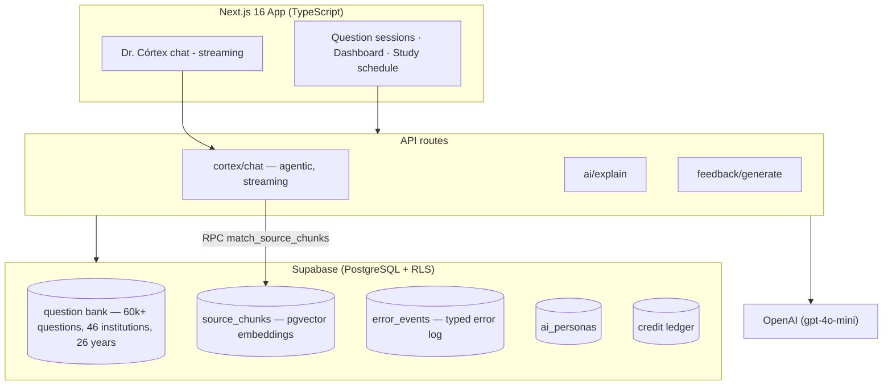
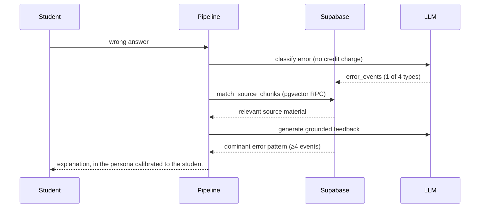

# AprovaMed+ — Architecture

Technical deep-dive of [AprovaMed+](https://aprovamedmais.com.br), an AI-powered medical education
platform for Brazilian students (1st year through residency prep). Founded, designed and built solo.

> The product thesis: every question bank tells you **what** you got wrong.
> AprovaMed+ tells you **why** — and adapts the AI tutor to your error pattern.

The codebase is private (commercial product); this repo documents the architecture and the
engineering decisions behind it.

## System overview

## The core: 3-phase error-diagnosis pipeline

Most platforms stop at right/wrong. AprovaMed+ runs every wrong answer through a pipeline:

**Phase 1 — Error classification.** A dedicated LLM call classifies each miss into one of four
types: *conceptual gap*, *concept confusion*, *misreading*, or *slip*. Stored in `error_events`.
This call is free for the student (doesn't debit credits) — diagnosis is infrastructure, not a feature
you pay per use.

**Phase 2 — Grounded explanation (RAG).** Explanations retrieve from `source_chunks` via a
pgvector similarity search exposed as a `security definer` RPC (`match_source_chunks`), so the
tutor cites real source material instead of hallucinating. Ingestion pipeline built from scratch.

**Phase 3 — Adaptive persona.** Once a dominant error pattern emerges (minimum 4 occurrences),
Dr. Córtex's persona adjusts tone and depth: a student who keeps misreading gets a different
tutor than one with conceptual gaps. Personas live in an `ai_personas` table and are composed
at prompt-build time with the student's weak/strong topic tags.

## Dr. Córtex — the AI tutor

- **Agentic chat** with OpenAI function calling: 7 tools, 4 session modes, streamed responses
- Prompt composition injects student context: weak/strong topic tags + error pattern
- Implemented directly over the OpenAI API (no agent framework) — full control over
  streaming, tool dispatch and token spend at this scale

## Engineering decisions

| Decision | Why |
| --- | --- |
| gpt-4o-mini everywhere | Education margins don't survive frontier-model pricing; quality is recovered via RAG grounding + tight prompts |
| Credit system gating LLM calls | Hard cost ceiling per user; diagnosis calls exempt so the data flywheel never stops |
| Supabase (Postgres + RLS + pgvector) | One datastore for app data, embeddings and auth, with row-level security from day one |
| Classification as a separate call | Keeps diagnosis deterministic-ish and cheap, independent of the conversational flow |
| Error data as first-class asset | `error_events` powers the adaptive persona today and cohort analytics (B2B white-label) tomorrow |

## Stack

`Next.js 16` `TypeScript` `Supabase (PostgreSQL, pgvector, RLS)` `OpenAI API` `Railway`

---

**Live product:** [aprovamedmais.com.br](https://aprovamedmais.com.br) · 50 users, first commercial
partnership closed (UFC medical academic league, Nov 2026–Jan 2027)

Matheus Quintela · [LinkedIn](https://linkedin.com/in/matheus-quintela) · mathheusquintela@gmail.com
